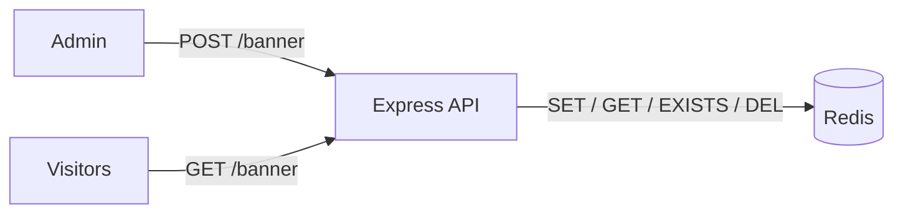
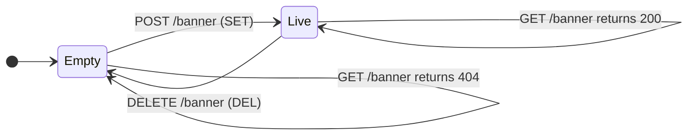
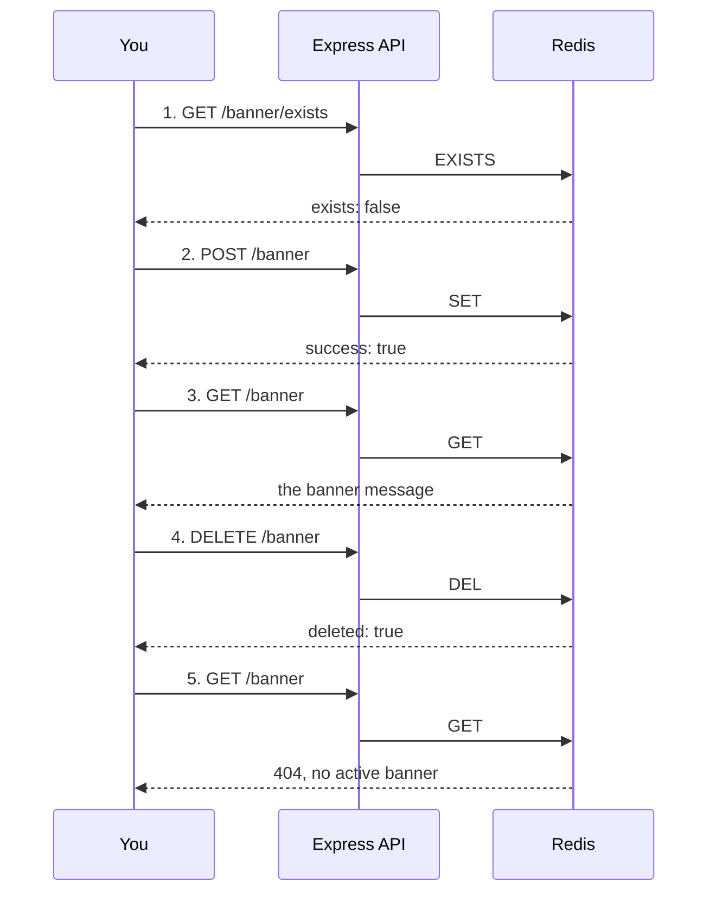

<div align="center">

# Site Banner, Powered by Redis

### One tiny key. Thousands of page loads. Zero database stress.

*A hands-on Node.js + Express project that teaches Redis by building something real: a site-wide "Hello Bar" that updates in an instant.*


<br>

<table>
  <tr>
    <td align="center"><h2>1</h2><sub>REDIS KEY</sub></td>
    <td align="center"><h2>4</h2><sub>ENDPOINTS</sub></td>
    <td align="center"><h2>4</h2><sub>REDIS COMMANDS</sub></td>
    <td align="center"><h2>3 min</h2><sub>TO RUN LOCALLY</sub></td>
  </tr>
</table>

</div>

---

## The Story

Imagine your website has a banner at the very top:

> **Big Sale! Get 50% off today!**

Every visitor, on every page, needs to see it. If each page load asked your main database for that one line of text, you'd be burning resources on the *simplest question imaginable*.

**Redis fixes that.** It keeps the banner in memory, so reading it takes a fraction of a millisecond. Marketing changes the message? One request, and the whole site updates.

This project is the smallest possible version of that idea, built so you can read the entire codebase in a few minutes and actually *understand* it.

### The difference at a glance

```text
 WITHOUT REDIS     every single page load
 ───────────────────────────────────────────────────────────
 Visitor ──▶ App ──▶ [ Primary Database ] ──▶ App ──▶ Visitor
                      query runs again and again

 WITH REDIS        one lookup, straight from memory
 ───────────────────────────────────────────────────────────
 Visitor ──▶ App ──▶ [ Redis ] ──▶ App ──▶ Visitor
                      key already waiting in RAM
```

```text
 RELATIVE WORK PER PAGE LOAD   (illustrative, not a benchmark)

 Primary database  |██████████████████████████████|  full query, every time
 Redis             |███                           |  single key lookup
```

---

## How It Works



Four endpoints. Four Redis commands. That's the whole game.

| You do this | The API calls | Redis runs |
| :-- | :-- | :-- |
| Publish a banner | `POST /banner` | `SET` |
| Show the banner | `GET /banner` | `GET` |
| Is there a banner? | `GET /banner/exists` | `EXISTS` |
| Take it down | `DELETE /banner` | `DEL` |

### The life of a banner



---

## Built With

| Tool | Why it's here |
| :-- | :-- |
| **Node.js** (ES Modules) | Modern JavaScript runtime |
| **Express.js** | Minimal, friendly web framework |
| **ioredis** | Rock-solid Redis client for Node |
| **Docker Compose** | Redis running in one command, nothing to install |
| **dotenv** | Keeps configuration out of your code |

---

## What's Inside

```text
.
├── docker-compose.yml   # Spins up Redis (with persistence turned on)
├── package.json         # Dependencies & scripts
├── .env.example         # Config template
├── .env                 # Your local config (never commit this!)
└── src/
    └── index.js         # The server + all the Redis logic
```

---

## Quick Start (about 3 minutes)

**You'll need:** [Node.js](https://nodejs.org/) v18+ and [Docker](https://www.docker.com/).

```text
 [1] Clone ──▶ [2] Install ──▶ [3] Configure ──▶ [4] Redis up ──▶ [5] Launch
```

**Step 1: Grab the code**

```bash
git clone https://github.com/your-username/03-site-banner-project.git
cd 03-site-banner-project
```

**Step 2: Install dependencies**

```bash
npm install
```

**Step 3: Set up your environment**

```bash
cp .env.example .env
```

Your `.env` should contain:

```env
PORT=3000
REDIS_URL=redis://localhost:6379
```

**Step 4: Wake up Redis**

```bash
docker compose up -d
```

> Redis runs with **AOF persistence** (`--appendonly yes`) and a Docker volume, so your banner survives restarts.

**Step 5: Launch the server**

```bash
npm run dev
```

If you see this, you're live:

```text
Server is listening on http://localhost:3000
```

---

## Take It for a Spin

Open a terminal and try these in order. Watch the story unfold.



**1. Is there a banner yet?**

```bash
curl http://localhost:3000/banner/exists
# → { "exists": false }
```

**2. Publish one**

```bash
curl -X POST http://localhost:3000/banner \
  -H "Content-Type: application/json" \
  -d '{"message": "Big Sale! Get 50% off today!"}'
# → { "success": true, "message": "Big Sale! Get 50% off today!" }
```

**3. Read it back**

```bash
curl http://localhost:3000/banner
# → { "message": "Big Sale! Get 50% off today!" }
```

**4. Take it down**

```bash
curl -X DELETE http://localhost:3000/banner
# → { "success": true, "deleted": true }
```

**5. Try reading again**

```bash
curl http://localhost:3000/banner
# → { "message": "No active banner found" }   (404)
```

---

## API Reference

| Method | Route | Success | Failure |
| :-- | :-- | :-- | :-- |
|  | `/` | `200` greeting text | none |
|  | `/banner` | `200` saved message | none |
|  | `/banner` | `200` banner message | `404` no active banner |
|  | `/banner/exists` | `200` true or false | none |
|  | `/banner` | `200` deleted flag | none |

Expand any endpoint below for the full request and response.

<details>
<summary><b>GET /</b> — Health check</summary>

Returns a simple greeting:

```text
Lets learn redis with ankit
```

</details>

<details>
<summary><b>POST /banner</b> — Save or update the banner</summary>

**Headers:** `Content-Type: application/json`

**Body:**

```json
{ "message": "Big Sale! Get 50% off today!" }
```

**Response:**

```json
{ "success": true, "message": "Big Sale! Get 50% off today!" }
```

Tip: no message in the body? The API falls back to a default welcome message.

</details>

<details>
<summary><b>GET /banner</b> — Fetch the banner</summary>

**200 OK**

```json
{ "message": "Big Sale! Get 50% off today!" }
```

**404 Not Found**

```json
{ "message": "No active banner found" }
```

</details>

<details>
<summary><b>GET /banner/exists</b> — Check if a banner is live</summary>

Lightweight check that doesn't fetch the full message.

```json
{ "exists": true }
```

</details>

<details>
<summary><b>DELETE /banner</b> — Remove the banner</summary>

```json
{ "success": true, "deleted": true }
```

</details>

---

## Redis Cheat Sheet (What You'll Learn)

```text
   SET  ──▶  store it        GET  ──▶  read it
   EXISTS ─▶ check it        DEL  ──▶  remove it
```

| Redis Command | `ioredis` Method | In plain English |
| :-- | :-- | :-- |
| `SET key value` | `redis.set(key, value)` | "Remember this." |
| `GET key` | `redis.get(key)` | "What did I ask you to remember?" |
| `EXISTS key` | `redis.exists(key)` | "Do you remember anything under this name?" |
| `DEL key` | `redis.del(key)` | "Forget it." |

---

<div align="center">

<br>

```text
╔══════════════════════════════════════════════════════════╗
║                                                          ║
║      One key. One banner. One fast read from memory.     ║
║                                                          ║
║         If this helped you understand Redis,             ║
║         a star on the repo keeps the project alive.      ║
║                                                          ║
╚══════════════════════════════════════════════════════════╝
```

<a href="https://github.com/ankitsawdev/redis-website-banner-project">
  
</a>

<br><br>


<sub>Built to learn, shared to help. Fork it, break it, make it yours.</sub>

<br>

</div>